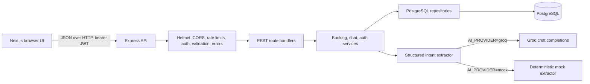

# Technical overview and assessment notes

This document describes the current implementation. Source code, migrations, and executable test scripts are the authority for application behavior.

## 1. Project objective and scope

The prototype demonstrates a full-stack appointment workflow: a customer creates an account, books through a multi-turn chatbot or a manual form, and views, modifies, or cancels their appointments. It is intentionally small enough to explain in an interview. AI extracts intent, while ordinary application code and PostgreSQL remain responsible for authorization, business rules, availability, and persistence.

The seed currently provisions one default business and three sample services: Consultation, Check-up, and Follow-up. `business_id` is present in the business-owned data model, but there is no business administration or onboarding UI.

## 2. Repository structure

```text
apps/
  api/
    src/
      middleware/        Authentication, chat limits, validation, error formatting
      repositories/      Parameterized PostgreSQL queries
      routes/            Express REST route handlers
      services/          Authenticated booking/chat rules and AI extraction
      test/               Node test-runner unit tests
  web/
    app/                 Next.js App Router page, global CSS, root layout
db/
  migrations/            Ordered SQL migrations
  schema.sql              Reference definition of the current schema
  seed.sql                Default business and three sample services
docs/                      API, setup, provider, decisions, and this overview
postman/                    YAML request/environment sources and generated JSON exports
scripts/                    Isolated Postman and integration harnesses
```

The route handlers currently also perform the controller role; there is no separate controller directory. SQL is kept in repositories, business decisions in services, and common request concerns in middleware.

## 3. Architecture



The frontend sends JSON requests to the API. Route handlers validate input, authenticated requests receive `userId` and `businessId` from a verified JWT, services enforce business rules, and repositories execute parameterized SQL using the shared `pg` pool. Chat uses the same booking service as manual booking. The AI provider only returns structured intent; it cannot directly write appointment data.

## 4. Frontend

The web workspace uses Next.js 15 App Router, React 19, and TypeScript. The current UI is a single client-side page in `apps/web/app/page.tsx` with two main states:

- **Signed out:** registration and login forms with native required/type/length constraints, password show/hide, terms checkbox, and success/error feedback.
- **Signed in:** chat and appointments tabs, account menu, recent-chat sidebar, chat composer and quick replies, manual service/date/time form, and appointment list with cancel actions.

The page owns API calls, account state, session state, and booking form state. Shared visual tokens, components, responsive breakpoints, focus styles, and reduced-motion styling live in `apps/web/app/globals.css`. The booking form remains available independently of the AI. A mobile layout stacks the conversation sidebar, chat, and booking panel so the page can scroll vertically.

Authentication uses bearer tokens in Web Storage: `localStorage` when “keep me signed in” is selected and otherwise `sessionStorage`. This is functional for the prototype but increases the impact of a cross-site scripting flaw; see security limitations below. The application does not use a frontend routing/auth framework or a separate API client package.

## 5. Backend REST API

The API is an Express 5 TypeScript process. Responses use `{ "data": ... }` on success and `{ "error": { "code", "message", "details?" } }` for errors. Unknown `/api` paths return JSON 404 responses. Malformed JSON returns HTTP 400. Unexpected internal errors are returned as generic HTTP 500 responses without stack traces or database/provider details.

| Method and path | Authentication | Purpose |
| --- | --- | --- |
| `GET /` | No | API information and endpoint hints |
| `GET /health` | No | API and PostgreSQL connectivity check |
| `POST /api/auth/register` or `/api/auth/signup` | No | Register and return user plus JWT |
| `POST /api/auth/login` | No | Authenticate and return user plus JWT |
| `GET /api/auth/me` | Bearer JWT | Return current profile |
| `GET /api/business` | Bearer JWT | Return business timezone and booking rules |
| `GET /api/appointments/services` | Bearer JWT | List active services |
| `GET /api/appointments/availability` | Bearer JWT | Return available slots for service and local date |
| `POST /api/appointments` | Bearer JWT | Create a manual appointment |
| `GET /api/appointments` | Bearer JWT | List only the current user's appointments |
| `PATCH /api/appointments/:id/cancel` | Bearer JWT | Cancel an active appointment |
| `DELETE /api/appointments/:id` | Bearer JWT | Compatibility alias for cancellation |
| `GET /api/chat/sessions` | Bearer JWT | List recent sessions for the current user |
| `POST /api/chat/sessions` | Bearer JWT | Create or reuse an empty session |
| `GET /api/chat/sessions/:id` | Bearer JWT | Retrieve an owned session and messages |
| `POST /api/chat/sessions/:id/messages` | Bearer JWT | Append a user message and run the assistant flow |
| `POST /api/assistant/chat` | Bearer JWT | Stateless structured assistant endpoint |

The exact request shapes and common error codes are in [API.md](API.md).

## 6. Authentication and security

- Registration lowercases and validates email, checks name/password constraints, hashes passwords with bcrypt (cost 12), and returns a JWT.
- Passwords must be 8–128 characters, contain a letter and number, and fit bcrypt's 72-byte UTF-8 limit. Login failures use a generic message.
- JWTs contain the user as `sub` and a business identifier, expire after seven days, and are verified with the expected issuer. Protected repositories also constrain queries by business/user ownership.
- Production configuration requires Groq, HTTPS frontend origin, non-loopback database/frontend endpoints, and rejects known placeholder/default JWT secrets. Credentials come from environment configuration; examples contain placeholder values.
- Helmet sets common HTTP security headers. CORS allows the configured exact frontend origin plus loopback development origins outside production. API and auth rate limits are configured in Express middleware.
- Pino request logging omits health checks and redacts authorization/cookie and API-key-shaped values. Raw request bodies and raw provider errors are not returned to clients.

Rate limits are process-local: a global API limit of 100 requests/minute, an auth limit of 10 attempts per 15 minutes in production (higher in non-production), and a shared per-user limit of six chat/assistant POST requests per minute. Horizontally scaled API instances would need a shared limiter store.

Known security follow-up: move bearer tokens from Web Storage to secure HttpOnly cookies with CSRF protection before exposing the app to real customers; add token revocation/session management and define email verification/recovery policies if required. There is no password reset, email verification, social login, or refresh-token flow.

## 7. Groq and conversational flow

Groq is the only hosted provider in the implementation. `apps/api/src/services/assistant.ts` calls the OpenAI-compatible Groq chat-completions endpoint with the configured model and JSON response format. A Zod schema validates the returned service name, ISO date, 24-hour time, confirmation flag, and change-request flag. The default model identifier is `openai/gpt-oss-120b`; requests time out after 10 seconds and are not retried. Provider failure is converted into a manual-form fallback. The key stays on the API server.

When `AI_PROVIDER=mock`, deterministic parsing is used for local tests. The isolated Postman and full integration harnesses explicitly start an API in mock mode, so their success demonstrates API/database workflows and mock intent extraction, not live Groq quality or availability. `groq-provider.test.ts` stubs `fetch` to verify request formatting and a rate-limit response; it does not contact the real Groq service.

### Multi-turn booking

1. The API loads the authenticated user's session state and recent persisted messages.
2. Up to six latest messages are sent to the extractor in chronological order. The repository can retrieve the latest 200 messages for UI history while preserving chronology.
3. The extractor proposes service/date/time fields. Application code matches active services, resolves local dates/times in the business timezone, validates rules, and asks PostgreSQL for availability.
4. If details are missing, chat asks a follow-up question. If the slot is occupied, it offers alternatives or asks for another time.
5. Once an available slot is proposed, the user must explicitly confirm in a new message. Booking creation checks the message text independently; the AI `isConfirmation` field alone cannot create a booking.
6. The service inserts the appointment. The chatbot returns `booked` only after the database call succeeds. A database overlap conflict is surfaced as an unavailable slot.

The assistant stores the pending booking in the chat session, messages in `chat_messages`, and provider outcome/parsed intent/latency metadata in `ai_logs`. It does not store the full sent conversation as the AI audit request payload.

### Modification and cancellation

Modification is handled by chat service logic based on the current authenticated user's active appointments and persisted conversation state. If exactly one appointment can be identified, the assistant asks for or parses a replacement time. When multiple active appointments could match, it asks the user to identify one by its current date/time. The booking service validates the proposed time, checks availability while excluding the same appointment row, and updates it. The existing appointment ID is preserved; the chatbot confirms only after the update succeeds. An unavailable time leaves the original row intact.

Cancellation is available from the appointments UI/API. It updates the appointment status to `cancelled` rather than deleting the row; cancelled slots no longer participate in overlap checks.

## 8. PostgreSQL design

`db/migrations/001_initial.sql` creates the initial core schema. `002_business_chat_timezone.sql` evolves it with business scoping, timezone, chat sessions/messages, AI logs, and current booking status/source rules. `db/schema.sql` documents the intended current schema; `db/seed.sql` inserts the default business and sample services idempotently.

| Table | Purpose and relationships |
| --- | --- |
| `businesses` | Business identity, unique slug, IANA timezone. |
| `users` | Customer name, globally unique email, bcrypt password hash, business foreign key. |
| `services` | Business-owned service name, duration (5–480 minutes), and active flag. |
| `appointments` | Business/user/service foreign keys, start/end timestamps, `booked`/`cancelled` status, `chat`/`form` source. |
| `chat_sessions` | Business/user-owned conversation, title, pending booking JSON, timestamps. |
| `chat_messages` | Business/session-owned user or assistant content and action metadata JSON. |
| `ai_logs` | Business/session-owned structured request/response metadata, latency, and safe error code. |

Composite foreign keys prevent appointments or chat sessions from crossing business ownership. Appointments require `ends_at > starts_at`. A partial PostgreSQL GiST exclusion constraint rejects overlapping booked ranges within one business; the range is half-open (`[)`), so adjacent appointments can touch. Indexes support user appointment listings, active services, session recency, chat history, and AI log history. The migrations require PostgreSQL's `pgcrypto` and `btree_gist` extensions.

The database email constraint is global (`users.email UNIQUE`), matching the current single-default-business prototype. Multi-business onboarding and per-business email uniqueness have not been implemented.

## 9. Validation, errors, and booking rules

Zod validates auth inputs, chat messages, appointment request bodies, IDs, and dates. The API has centralized handling for Zod errors, application `HttpError`s, malformed JSON, common PostgreSQL conflicts, unknown API routes, and unexpected errors. Internal stack traces are not sent in JSON responses.

Current booking policy is encoded in `apps/api/src/services/booking-rules.ts` and `booking.ts`:

- Business-local timezone; seeded default is `Europe/London`.
- Monday through Friday, 09:00–17:00 local opening hours.
- Appointment starts every 30 minutes, bounded by the service duration and closing time.
- At least 60 minutes' lead time and no more than 30 days in advance.
- Invalid calendar dates, nonexistent daylight-saving local times, invalid slot alignment, and occupied intervals are rejected.
- Availability returns valid slots for the requested local date; past or out-of-window dates can return an empty slot list rather than a date-level error.

## 10. Testing and verification

### Automated tests present

The Node test-runner suite includes tests for:

- Mock assistant extraction and context carried across messages.
- Operating hours, weekends, lead time, booking horizon, slot alignment, timezone conversion, and daylight-saving gaps.
- Explicit booking confirmation, ambiguous and negative messages, and AI false-positive confirmation protection.
- Recent message retrieval ordering and AI context selection beyond 200 stored messages.
- JSON 404, malformed JSON, validation/application errors, and safe unexpected-error responses.
- Groq request shape/structured response and simulated HTTP 429 handling.

There is no separate frontend test suite. Full API flows and PostgreSQL persistence are exercised by the isolated integration harness; Postman covers the HTTP collection. The database-backed runners are safe only when pointed at an empty, disposable local `*_test` database. They run migrations and seed data there and remove created test users; they do not use the development URL. They do not make live Groq calls.

### Results and evidence level

| Check | Result | Evidence qualification |
| --- | --- | --- |
| Unit suite | 20 passed, 0 failed, 0 skipped | Observed local run via `npm test`; tests are offline and include stubbed Groq HTTP. |
| Full isolated integration | 51 passed, 0 failed | The project owner reports this as the most recent successful run. It was not rerun during documentation preparation. A later local attempt was blocked before connecting because `TEST_DATABASE_URL` was unavailable and local PostgreSQL did not respond. |
| Postman | 28 requests, 68 assertions, 0 failures | Previously reported successful run supplied by the project owner. It was not rerun during documentation preparation; the later runner invocation stopped before Newman because the test URL was missing. |
| API TypeScript build | Passed | Observed local build. |
| Frontend production build | Passed | Observed local Next.js build. The combined root build encountered a Windows `EPERM` once while creating a Next.js generated directory; a standalone frontend build subsequently succeeded. |

Historical successful results should not be interpreted as a fresh rerun of the current checkout. To reproduce the database suites, start local PostgreSQL, configure a disposable test URL as described in [local-postgres-setup.md](local-postgres-setup.md), and run the documented commands.

## 11. Local setup and environment

Requirements: Node.js 20+, npm, PostgreSQL 15+ with `pgcrypto` and `btree_gist`. From the root:

```powershell
npm install
Copy-Item .env.example .env
```

Set private local values in `.env` (or the process environment): `DATABASE_URL`, `JWT_SECRET`, `AI_PROVIDER`, and—when using Groq—`GROQ_API_KEY`. Also review `GROQ_MODEL`, `PORT`, `TRUST_PROXY_HOPS`, `FRONTEND_ORIGIN`, and `NODE_ENV`. Then:

```powershell
npm run db:migrate
npm run db:seed
npm run dev
```

The root scripts also provide `npm test`, `npm run build`, `npm run test:postman`, `npm run test:integration`, and `npm run test:all`. `NEXT_PUBLIC_API_URL` is a public build-time frontend setting, not a secret. It supplies the API base URL ending in `/api`; loopback browsing defaults to the local API.

Environment examples intentionally show placeholders only. Do not publish `.env` or actual passwords, tokens, API keys, or database URLs.

## 12. Design decisions and tradeoffs

- **AI extracts; application code decides.** This makes provider output advisory and keeps booking safety auditable and testable.
- **Chat and manual form share the booking service.** Booking policy is consistent even when Groq is unavailable.
- **PostgreSQL enforces overlap safety.** Application checks provide useful responses, while the exclusion constraint handles concurrent races.
- **REST and persisted polling-style chat history instead of WebSockets/SSE.** This keeps the prototype straightforward; streaming was an optional assessment extra and is not implemented.
- **SQL migrations and repositories rather than an ORM.** The schema, constraints, and parameterized queries remain visible for review.
- **One default business and globally unique email.** Business ownership is modeled for scoping, while onboarding/admin workflows and true tenant management remain outside the prototype.
- **Mock provider for integration tests.** Deterministic tests avoid provider quota and network flakiness; live Groq quality needs a separate manual or credentialed smoke test.

## 13. Assumptions and limitations

- One seeded default business, no business creation or admin portal.
- Fixed weekday hours and one configured timezone; no holidays, staff calendars, per-service hours, capacity, locations, or resource scheduling.
- Sample service list is seeded in SQL; no service management UI.
- Customer self-service only; no email verification, password recovery, social login, notifications, payments, calendar sync, or reminders.
- No streaming AI responses. Groq has one request attempt and a 10-second timeout; fallback booking remains manual.
- JWT bearer tokens are stored in browser Web Storage. There is no refresh/revocation flow.
- Chat transcripts are persisted; retention, deletion, consent, and privacy disclosures need a documented policy.
- API rate limits use in-memory storage, which is not shared across multiple instances.
- Integration/Postman success depends on an explicitly configured disposable database and PostgreSQL being available.
- Test results documented above include historical owner-reported database-suite runs; live Groq was not tested by the mock integration suite.

## 14. Assessment coverage map

| Assessment requirement | Status | Evidence |
| --- | --- | --- |
| Functional full-stack prototype | Implemented | `apps/web/app/page.tsx`, `apps/api/src/index.ts`, `db/schema.sql` |
| Signup, login, protected APIs | Implemented | `apps/api/src/routes/auth.ts`, `apps/api/src/middleware/auth.ts` |
| Frontend UX, loading/error/empty feedback, responsive layout | Implemented; manual cross-device/accessibility review remains | `apps/web/app/page.tsx`, `apps/web/app/globals.css` |
| REST API, input validation, consistent JSON errors | Implemented | `apps/api/src/routes/`, `apps/api/src/middleware/` |
| PostgreSQL relationships, migrations, indexes, conflict protection | Implemented | `db/migrations/`, `db/schema.sql`, `db/seed.sql` |
| AI-assisted multi-turn booking and fallback | Implemented; live provider results are not established by mock suite | `apps/api/src/services/assistant.ts`, `apps/api/src/services/chat.ts` |
| Explicit confirmation before booking | Implemented and unit-tested | `apps/api/src/services/booking-confirmation.ts`, `apps/api/src/test/chat-confirmation.test.ts` |
| Existing booking modification and cancellation | Implemented | `apps/api/src/services/chat.ts`, `apps/api/src/services/booking.ts`, appointment routes |
| Unit and integration verification | Implemented; integration evidence is historical/reported | `apps/api/src/test/`, `scripts/full-integration-test.mjs` |
| Postman HTTP workflow | Implemented; prior result reported as 28 requests/68 assertions | `postman/collections/`, `scripts/run-postman.mjs` |
| Streaming, dark mode, payment, reminders, admin, calendar sync | Not implemented; optional or out of core scope | No corresponding feature implementation. |

## Related documentation

- [REST API reference](API.md)
- [Local PostgreSQL and test database setup](local-postgres-setup.md)
- [Groq integration](groq-integration.md)
- [Architecture decisions](decisions.md)
